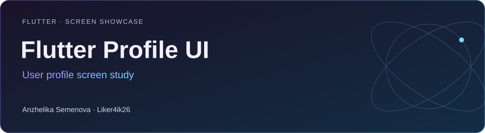

# Flutter Profile UI

**Flutter · Screen showcase** · Flutter · Dart · Riverpod / Hooks · flutter_svg

Учебная работа по интерфейсу пользовательского профиля: подключённые услуги, тарифы, интересы и дополнительная информация.

[Портфолио автора](https://portfolio.semenova-anzhelika.online/) · [Профиль GitHub](https://github.com/Liker4ik26) · [Исходники](https://github.com/Liker4ik26/laba_flutter/tree/refactor_user_profile)

> На главной ветке сохранена галерея; исходники доступны в refactor_user_profile. Команда клонирования выбирает ветку с кодом.

## Как выглядит проект

| Интерфейс | Сценарии |
| :---: | :---: |
| <br/>Экран 1 | <br/>Экран 2 |

## Что в проекте

- Экран пользовательского профиля, услуги, тарифы и интересы.
- Разделение экрана на повторно используемые компоненты.
- Темы, локализация и выбор изображения через image_picker.

## Технологии

| Направление | Реализация |
| :--- | :--- |
| Стек | Flutter · Dart · Riverpod / Hooks · flutter_svg |
| Формат | Flutter · Screen showcase |
| Окружение | Flutter 3.13.7 / Dart 3.1.3 либо совместимый SDK |

## Как запустить

Требования: Flutter 3.13.7 / Dart 3.1.3 либо совместимый SDK.

```bash
git clone --branch refactor_user_profile https://github.com/Liker4ik26/laba_flutter.git
cd laba_flutter
flutter pub get
```

```bash
flutter run
```

## English overview

**Flutter Profile UI — User profile screen study.**

Flutter · Screen showcase. Stack: Flutter · Dart · Riverpod / Hooks · flutter_svg. The full application source is in the `refactor_user_profile` branch. [Explore my professional portfolio](https://portfolio.semenova-anzhelika.online/).

---

**Автор — Анжелика Семёнова · [Liker4ik26](https://github.com/Liker4ik26)**

[Сайт](https://portfolio.semenova-anzhelika.online/) · [Telegram](https://t.me/Liker4ik50) · [Почта](mailto:pr110oat18@gmail.com)
